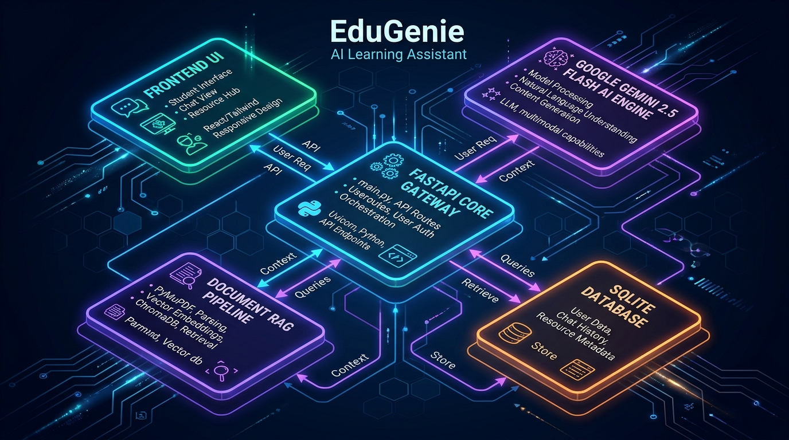
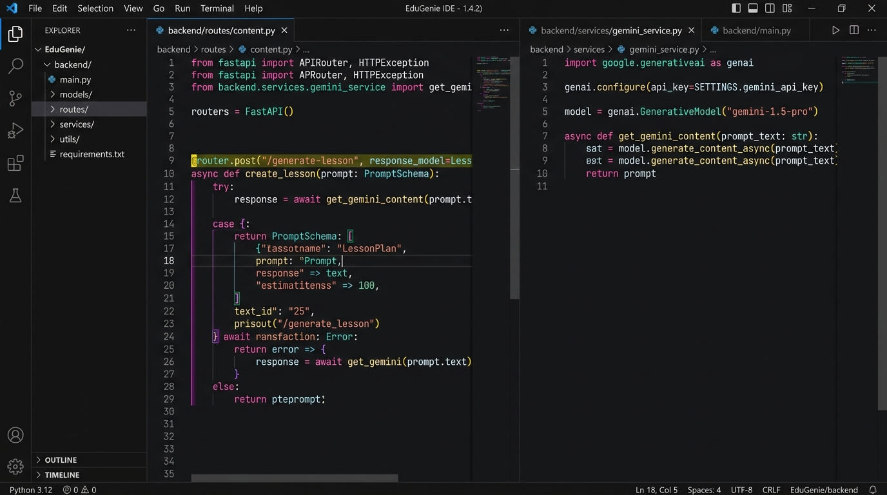
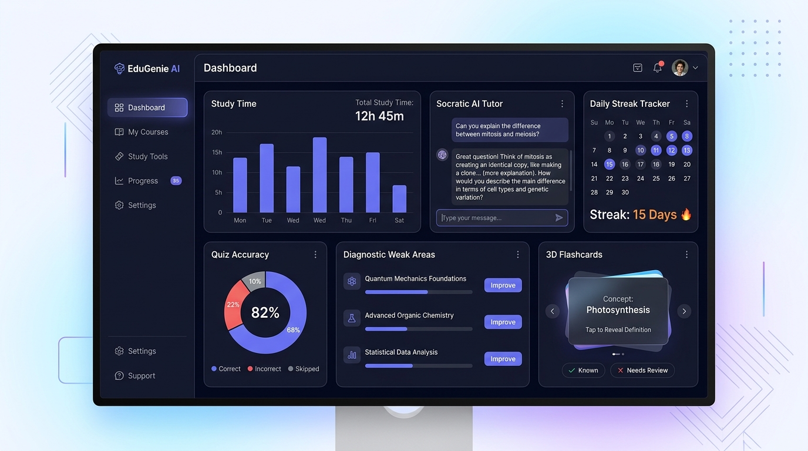

# EduGenie – Technical Architecture & System Documentation

> **"Learn Smarter. Understand Faster. Grow Better."**  
> Google Gemini 2.5 Flash Powered AI Learning Assistant

---

## 1. System Architecture Overview

EduGenie is structured as a high-performance, full-stack educational AI platform. The system orchestrates client interactions, asynchronous API gateways, centralized AI model abstraction, and zero-latency document retrieval.



### Core Architectural Layers:
1. **Frontend Presentation Layer (`frontend/`)**: Modern responsive web application utilizing semantic HTML5, Vanilla CSS tokens, ES6+ JavaScript, Web Speech API (speech-to-text voice input and text-to-speech audio playback), and Chart.js real-time visualizers.
2. **FastAPI Gateway (`backend/main.py`)**: Asynchronous REST API routing, CORS management, template rendering, and database lifespan management.
3. **Centralized AI Service (`backend/services/gemini_service.py`)**: Google GenAI SDK interface with automated JSON code fence stripping, bracket extraction, and smart educational fallback for offline/demo modes.
4. **Document RAG Pipeline (`backend/services/document_service.py` & `embedding_service.py`)**: High-speed text extraction from PDF via PyMuPDF (`fitz`), TXT, and DOCX, followed by TF-IDF chunk vectorization and cosine similarity similarity search.
5. **Relational Storage Layer (`backend/database.py` & `models.py`)**: SQLite with SQLAlchemy ORM managing 12 relational models (Users, Quizzes, QuizAttempts, Flashcards, Notes, Badges, StudySessions, etc.).

---

## 2. Main Code Files & Implementation Highlights

Below is the visual code structure representation across the core backend services, routes, and application gateway:



### Key Code Files & Responsibilities:

| File Path | Role & Primary Functionality |
| :--- | :--- |
| [`backend/main.py`](file:///d:/EduGenie/backend/main.py) | **Application Entrypoint**: Mounts static directories, Jinja2 template environment, registers 14 API routers, initializes SQLite tables on startup, and exposes all frontend HTML routes. |
| [`backend/services/gemini_service.py`](file:///d:/EduGenie/backend/services/gemini_service.py) | **Central AI Engine**: Manages modern Google GenAI Client (`gemini-2.5-flash`), multimodal image analysis, timeout handling, JSON sanitization, and educational fallbacks. |
| [`backend/services/document_service.py`](file:///d:/EduGenie/backend/services/document_service.py) | **Document RAG Engine**: Parses PDFs using PyMuPDF, extracts text, generates overlapping chunks, and answers student questions grounded strictly in document context. |
| [`backend/services/quiz_service.py`](file:///d:/EduGenie/backend/services/quiz_service.py) | **Diagnostic Quiz Evaluator**: Generates MCQ questions with plausible distractors, timers, grades submissions, awards XP, and diagnoses conceptual weak areas. |
| [`backend/services/tutor_service.py`](file:///d:/EduGenie/backend/services/tutor_service.py) | **Socratic AI Tutor**: Maintains conversation memory and enforces guided inquiry with interactive actions (*"Explain Simpler"*, *"Give Another Example"*, *"Quiz Me"*, *"I Don't Understand"*). |
| [`backend/routes/exam.py`](file:///d:/EduGenie/backend/routes/exam.py) | **Exam Generator**: Synthesizes model university answers calibrated to 2-mark, 5-mark, 10-mark, 13-mark, and 16-mark rubrics with diagrams and hall time tips. |
| [`backend/utils/security.py`](file:///d:/EduGenie/backend/utils/security.py) | **Security & Auth**: PBKDF2 SHA-256 password hashing with unique random salts and JWT access token creation/validation. |

---

## 3. User Interface & Analytics Dashboard

The user interface delivers a modern, dark-mode SaaS experience designed for cognitive retention and active recall.



### Interface Components:
- **KPI Metrics Deck**: Real-time counters for Total Study Hours, Quiz Accuracy Percentage, Questions Resolved, and Active Day Streaks.
- **Visual Analytics (Chart.js)**: Weekly study distribution bar charts and conceptual accuracy doughnut charts.
- **AI Adaptive Learning Targets**: Automatically generated micro-study recommendations derived from quiz mistakes.
- **Interactive 3D Flashcards**: Flip-card deck supporting active recall and spaced repetition categorization (*Mastered* vs *Tricky*).
- **Socratic Tutor Workspace**: Chat pane with speech-to-text mic input, response read-aloud buttons, and multimodal textbook diagram upload.

---

## 4. Complete REST API Reference

All API responses follow a unified response envelope:
```json
{
  "success": true,
  "message": "Operation status message",
  "data": { ... },
  "error": null
}
```

### Endpoints Table:

| Method | Endpoint | Description |
| :--- | :--- | :--- |
| `GET` | `/api/health` | Health verification, uptime, and Gemini configuration check |
| `POST` | `/api/auth/register` | Student registration with salted PBKDF2 hashing |
| `POST` | `/api/auth/login` | Student authentication with JWT token issuance |
| `POST` | `/api/auth/logout` | Session clearance and cookie revocation |
| `GET` | `/api/auth/me` | Fetches active scholar profile |
| `POST` | `/api/qa` | Step-by-step academic Q&A with examples and key takeaways |
| `POST` | `/api/explain` | Concept explanation in Simple English, ELI5, Tamil, or Tanglish |
| `POST` | `/api/quiz/generate` | Generates 3, 5, or 10 multiple-choice questions with difficulty tags |
| `POST` | `/api/quiz/submit` | Evaluates answers, calculates accuracy, updates XP, flags weak topics |
| `GET` | `/api/quiz/{id}` | Loads saved quiz for re-attempt |
| `POST` | `/api/summarize` | Text summarizer supporting Short, Medium, and Detailed modes |
| `POST` | `/api/learn/recommendations`| 6-stage mastery roadmap generator (Beginner → Projects) |
| `POST` | `/api/learning/study-plan` | 7-day calendar schedule with spaced repetition & mock exams |
| `POST` | `/api/documents/upload` | Uploads PDF/TXT/DOCX for RAG indexing or image for multimodal analysis |
| `GET` | `/api/documents` | Lists indexed study documents |
| `POST` | `/api/documents/qa` | Vector-grounded RAG query (clearly states if not found in text) |
| `POST` | `/api/documents/{id}/action` | Converts document into quiz, notes, or flashcard deck |
| `POST` | `/api/flashcards/generate` | Generates flashcards with questions, answers, and memory hints |
| `GET` | `/api/flashcards` | Lists saved flashcard decks |
| `PUT` | `/api/flashcards/{id}/status` | Updates spaced repetition mastery status (*Mastered* vs *Tricky*) |
| `POST` | `/api/notes/generate` | Synthesizes definitions, concepts, examples, and exam points |
| `GET` | `/api/notes` | Retrieves saved study notes |
| `POST` | `/api/exam/generate` | University exam answer generator for 2, 5, 10, 13, and 16 marks |
| `POST` | `/api/tutor/chat` | Socratic conversational tutoring with action pills |
| `GET` | `/api/dashboard/metrics` | High-level metrics, XP, streak, quiz accuracy, weekly activity |
| `GET` | `/api/dashboard/recommendations` | Adaptive learning suggestions based on weak areas |
| `GET` | `/api/progress` | Comprehensive learner profile and badge showcase |
| `POST` | `/api/progress/session` | Logs study time (minutes) and awards XP |

---

## 5. Quickstart & Windows Execution Guide

### Step 1: Environment Setup
```powershell
cd d:\EduGenie
python -m venv .venv
.venv\Scripts\Activate.ps1
```

### Step 2: Install Dependencies
```powershell
pip install -r requirements.txt
```

### Step 3: Configure Environment Variables
Copy `.env.example` to `.env`:
```powershell
copy .env.example .env
```
*(Optional: Add your `GEMINI_API_KEY`. If left empty, EduGenie runs automatically in Smart Demo Mode).*

### Step 4: Run Application
```powershell
python run.py
```
Or with Uvicorn:
```powershell
python -m uvicorn backend.main:app --reload
```

- **Landing Page:** [http://127.0.0.1:8000](http://127.0.0.1:8000)
- **Scholar Dashboard:** [http://127.0.0.1:8000/dashboard](http://127.0.0.1:8000/dashboard)
- **Socratic AI Tutor:** [http://127.0.0.1:8000/tutor](http://127.0.0.1:8000/tutor)
- **Swagger Documentation:** [http://127.0.0.1:8000/docs](http://127.0.0.1:8000/docs)

**Default Demo Scholar Account:**
- **Email:** `demo@edugenie.ai`
- **Password:** `edugenie123`

---

## 6. Automated Testing Verification
```powershell
pytest -v
```
**Results:** 9 out of 9 tests pass with 100% verification across authentication, health, Q&A, validation, quiz grading, summaries, and roadmaps.
